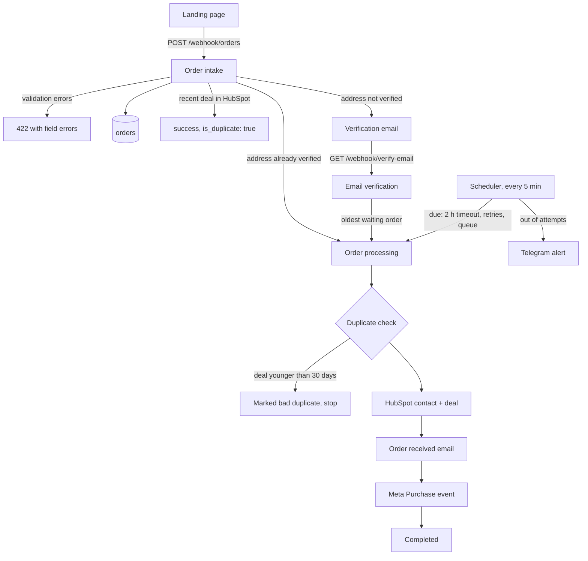

# Lead generation pipeline on n8n

An order processing pipeline for landing pages, built on self-hosted n8n and Postgres.
A landing page posts an order form to a webhook; the pipeline validates it, verifies the
customer's email address, detects duplicates in the CRM, creates the contact and the deal,
notifies the customer, reports the conversion to Meta and retries anything that failed.

It is a port of a production Laravel system to n8n, reduced to the parts that matter:
HubSpot as the CRM, transactional email, the Meta Conversions API and Telegram alerts.

## How an order flows



| Workflow | Trigger | Job |
|---|---|---|
| Order intake | `POST /webhook/orders` | Validate, save idempotently, pre-check for duplicates, answer the landing page, start processing or send the verification email |
| Email verification | `GET /webhook/verify-email` | Mark the address verified, release its waiting orders, redirect to the site's page |
| Order processing | called by the other three | Claim the order, then run each step once: duplicate check, HubSpot, email, Meta |
| Duplicate check | called by intake and processing | Find the customer in HubSpot by email or phone and classify the latest deal |
| Scheduler | every 5 minutes, or `POST /webhook/scheduler/run` with a key | Process due orders in batches, alert about orders that ran out of attempts |
| Error alert | failed execution of any workflow above | Report the workflow, node, error and execution link to Telegram |
| HubSpot setup | manual, once per account | Create the custom deal and contact properties |

## Design decisions

**State is a set of facts, not a status column.** An order has `blocked`, `duplicate`,
`completed_at`, `next_attempt_at`, `attempts`, `locked_at` and `failed_at`. One field,
`next_attempt_at`, drives everything the scheduler does: the 2-hour wait for the
verification click and the retry backoff are the same mechanism.

**Idempotency at two levels.** The landing page generates an `idempotency_key` per form
load; a repeated request returns the same order and the same answer. Inside processing,
every provider call writes a row to `provider_records` (unique per order and step), so a
retry skips the steps that already succeeded.

**Retries need no error handler.** Claiming an order schedules its next attempt up front
(15 min, 1 h, 3 h, 12 h, 24 h). A successful run clears it; a failed or crashed run needs no
cleanup, the order simply comes due again. After the sixth attempt the order is reported to
Telegram once.

**Two kinds of alerts.** Every failed execution is reported at once by a shared error
workflow, with the node and the error text. An order that ran out of attempts is reported
separately, once, as the case that needs a person.

**HubSpot is the only source of truth for duplicates.** A previous deal younger than the
site's threshold (30 days) makes a bad duplicate that is never processed; an older one makes
a good duplicate whose deal goes to a separate stage. Orders of one customer are processed
one at a time, at least a minute apart, so the second one can find the first one's deal.

**The contact is identity, the deal is a snapshot.** A HubSpot contact is created once and
never updated by the pipeline. Everything a customer can enter differently per order
(address, bank account, ID document, contact details) is stored on the deal. A public
webhook therefore cannot be used to overwrite an existing customer's data.

**Email verification belongs to the address.** Once an address is verified, later orders
from it are processed immediately. An unverified order is processed on the click or after
two hours, whichever comes first.

**Secrets live in n8n credentials, configuration in tables.** Sites, products and provider
settings are rows in the `leadgen` schema; in production a back-office app maintains them.
The repository holds no secrets.

## Repository layout

```
compose.yaml               n8n + Postgres (+ Mailpit with the dev profile)
compose.test.yaml          disposable local test stand with stubbed providers
db/schema.sql              leadgen schema, idempotent, applied on every deploy
db/seed.sql                demo site, products and providers
workflows/                 workflow exports, one JSON file each
credentials.example.json   credential ids the workflows refer to, without secrets
scripts/deploy.sh          upload compose.yaml, recreate containers, apply the schema
scripts/export.sh          n8n -> workflows/ (through the n8n API)
scripts/import.sh          workflows/ -> n8n (through the n8n CLI in the container)
scripts/sql.sh             run a SQL statement on the server database
scripts/order.sh           send a test order with fresh data
scripts/test.sh            run the unit or e2e tests
scripts/stand.sh           start, test and remove the local test stand
tests/unit/                Code nodes from the exports, run without n8n
tests/e2e/                 requests against a running instance
tests/stub/                stand-in for HubSpot, Meta and Telegram
test-payloads/             example order payloads
```

n8n Community Edition keeps workflows in its database and has no built-in Git sync, so the
JSON exports are the versioned form: build in the editor, `scripts/export.sh`, commit.

## Running it

Requirements: a host with Docker Compose reachable over SSH, an HTTPS reverse proxy in
front of port 5678, and locally `jq`, `curl` and Node 24.

1. **Server.** Copy `.env.example` to `.env` in the deploy directory on the server and fill
   it in. Set `COMPOSE_PROFILES=dev` to get Mailpit as a mail catcher.
2. **Stack and database.** `scripts/deploy.sh --seed` uploads `compose.yaml`, starts the
   containers and applies `db/schema.sql` and the demo data. Host, directory and docker
   command are set with `DEPLOY_HOST`, `DEPLOY_DIR`, `DEPLOY_DOCKER`.
3. **n8n.** Open the editor, create the owner account and an API key. Put `N8N_URL` and
   `N8N_API_KEY` into a local `.env`.
4. **Credentials and workflows.** Copy `credentials.example.json` to `credentials.json`,
   fill in the secrets and run `scripts/import.sh --credentials`. Publish the workflows in
   the editor; imported workflows arrive unpublished. Publish `Duplicate check` first, then
   `Order processing`, then the rest: n8n refuses to publish a workflow before the
   sub-workflows it calls.
5. **HubSpot.** Run the `HubSpot setup` workflow once, create a "Duplicate" deal stage and
   put the pipeline and stage ids into `leadgen.products`.
6. **Meta.** Put the pixel id (and, for testing, a `test_event_code`) into
   `leadgen.site_providers.settings` of the Meta provider.

Send an order:

```sh
scripts/order.sh            # new customer, unverified address
scripts/order.sh -v         # verified address, processed right away
scripts/order.sh -s         # same customer as the previous request
scripts/order.sh -r         # replay the previous request (same idempotency key)
```

### Synology notes

- The DSM firewall must allow `172.16.0.0/255.240.0.0`, otherwise containers cannot reach
  each other.
- Port 5432 on the host belongs to DSM's own Postgres; the stack publishes its database on
  `127.0.0.1:5433`.
- SSH tunnels (for a database client or the Mailpit UI) need `AllowTcpForwarding yes` in
  `/etc/ssh/sshd_config`.
- Docker requires root; the scripts call `sudo /usr/local/bin/docker`.

## Tests

```sh
scripts/test.sh          # unit: Code nodes from workflows/*.json with canned inputs, offline
scripts/stand.sh up      # start a throwaway stand on localhost with stubbed providers
scripts/stand.sh test    # e2e: the whole pipeline on the stand
scripts/stand.sh down
scripts/test.sh e2e      # the intake part of the e2e suite against the instance from .env
```

The unit tests load the JavaScript of the Code nodes straight from the exported workflows
and replace the neighbouring nodes with canned outputs, such as a HubSpot search response.
They cover validation, duplicate classification and the HubSpot mapping.

The test stand (`compose.test.yaml`) is a fresh n8n with its own Postgres, Mailpit and a
small stub server that plays HubSpot, Meta and Telegram. `scripts/stand.sh up` applies the
schema and the seed, imports the exports with the provider hosts pointed at the stub and
publishes them, so every run also proves that the repository installs from scratch. The e2e
tests post orders and then check the database, the mailbox and the requests the stub
received: full processing, the verification click, both kinds of duplicates, a provider
failure with its retry schedule and error alert. Scheduler behaviour is tested through its
second trigger, a key-protected webhook that runs one pass and answers when it is done: the
two-hour timeout, a retry, the single alert for an exhausted order and the spacing between
one customer's orders. Needs only Docker, `jq` and Node.

The same two suites run in GitHub Actions on every push.

Not covered: the real provider APIs, whose behaviour the stub only imitates. In particular,
the stub finds a new deal at once, while HubSpot's search index lags behind by seconds: the
tests prove that a customer's orders are spaced out, not that one minute is enough.

## Known limitations

- **The verification link is a GET that changes state.** Mail scanners that open links can
  verify an address on the customer's behalf.
- **One account per provider type.** A node is bound to one credential, so all sites share
  one HubSpot account, one SMTP server and one Meta token.
- **A deal can land on someone else's contact.** A match by phone, or by an unverified
  email, attaches the deal to the existing contact. The contact itself is not changed, and
  the deal carries the email and phone of the order.
- **Order numbers can have gaps.** Two simultaneous requests with the same new idempotency
  key can consume a sequence value.
- **Customers are told apart by email in the queue.** Orders with different addresses and
  the same phone can be processed at the same time.
- **Execution history stores payloads.** n8n keeps the input and output of every node,
  including personal data, for 14 days. A production setup should disable saving successful
  executions.
- **A failed alert is not retried.** An order is marked as reported before the Telegram
  message is sent.
- **Error alerts are not deduplicated.** An outage of a provider produces one message per
  failed execution.
